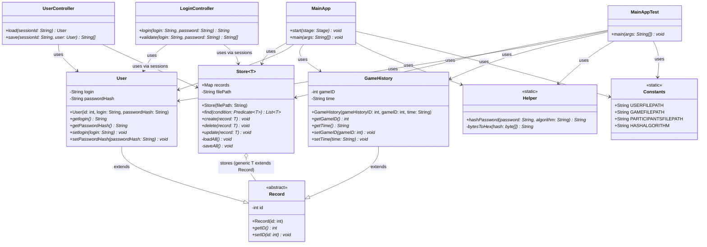

# UML Class Diagram - SENG300 Game Platform

## Class Descriptions

### Domain Classes (Package: ca.ucalgary.seng300.platform.domain)

#### Record (Abstract)
- **Purpose**: Base class for all persistent entities
- **Attributes**:
  - `id: int` - Unique identifier
- **Methods**:
  - `getID(): int` - Returns record ID
  - `setID(id: int): void` - Sets record ID

#### User (extends Record)
- **Purpose**: Represents a user account
- **Attributes**:
  - `login: String` - Username/login identifier
  - `passwordHash: String` - Hashed password
- **Methods**:
  - `getlogin(): String` - Returns login
  - `getPasswordHash(): String` - Returns password hash
  - `setlogin(login: String): void` - Updates login
  - `setPasswordHash(passwordHash: String): void` - Updates password hash

#### GameHistory (extends Record)
- **Purpose**: Records game history entries
- **Attributes**:
  - `gameID: int` - Reference to game
  - `time: String` - Timestamp of game
- **Methods**:
  - `getGameID(): int` - Returns game ID
  - `getTime(): String` - Returns timestamp
  - `setGameID(gameID: int): void` - Updates game ID
  - `setTime(time: String): void` - Updates timestamp

### Data Storage (Package: ca.ucalgary.seng300.platform.store)

#### Store<T extends Record> (Generic)
- **Purpose**: Generic data persistence layer using JSON serialization
- **Attributes**:
  - `records: Map<Integer, T>` - In-memory cache of records
  - `filePath: String` - Path to JSON file
- **Methods**:
  - `find(condition: Predicate<T>): List<T>` - Finds records matching condition
  - `create(record: T): void` - Adds new record and saves
  - `delete(record: T): void` - Removes record and saves
  - `update(record: T): void` - Updates record and saves
  - `loadAll(): void` (private) - Loads records from JSON file
  - `saveAll(): void` (private) - Persists records to JSON file

### Constants & Utilities (Package: ca.ucalgary.seng300.platform.constants/utils)

#### Constants
- **Purpose**: Centralized configuration constants
- **Static Attributes**:
  - `USERFILEPATH` - Path to user data file
  - `GAMEFILEPATH` - Path to game history file
  - `PARTICIPANTSFILEPATH` - Path to participants file
  - `HASHALGORITHM` - Password hashing algorithm (SHA-256)

#### Helper
- **Purpose**: Utility functions for common operations
- **Static Methods**:
  - `hashPassword(password: String, algorithm: String): String` - Hashes password using specified algorithm
  - `bytesToHex(hash: byte[]): String` (private) - Converts byte array to hex string

### Controllers (Package: ca.ucalgary.seng300.platform.controller)

#### UserController
- **Purpose**: Manages user profile operations
- **Methods**:
  - `load(sessionId: String): User` - Loads user by session
  - `save(sessionId: String, user: User): String[]` - Saves user changes

#### LoginController
- **Purpose**: Handles authentication
- **Methods**:
  - `login(login: String, password: String): String` - Authenticates user and returns session
  - `validate(login: String, password: String): String[]` - Validates login credentials

### Application (Package: ca.ucalgary.seng300)

#### MainApp
- **Purpose**: Main JavaFX application entry point
- **Methods**:
  - `start(stage: Stage): void` - Initializes JavaFX UI
  - `main(args: String[]): void` - Application main method

#### MainAppTest
- **Purpose**: Test/demonstration class
- **Methods**:
  - `main(args: String[]): void` - Tests Store, User, and GameHistory operations

## Architecture Overview

### Key Relationships

1. **Inheritance Hierarchy**: 
   - `User` and `GameHistory` extend the abstract `Record` class

2. **Generic Data Storage**:
   - `Store<T>` acts as a generic repository for any `Record` subtype
   - Provides CRUD operations with JSON persistence via Gson

3. **Separation of Concerns**:
   - **Domain**: Core business entities (User, GameHistory)
   - **Store**: Data persistence and access layer
   - **Controllers**: Business logic and user operations
   - **Utils**: Helper functions and constants

4. **Dependencies**:
   - Controllers depend on domain classes and stores
   - Application classes depend on all layers for integration testing
