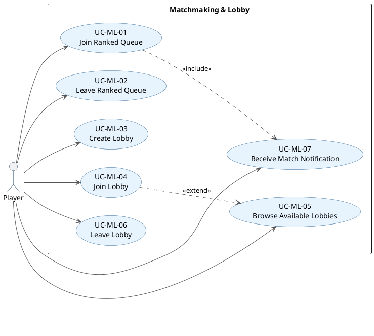

# 03.03 Matchmaking & Lobby Use Case Descriptions

## PlantUML Diagram

---

## UC-ML-01: Join Ranked Queue

**Primary actor:** Player
**Goal:** Enter the ranked matchmaking queue to be paired with an opponent automatically.
**Preconditions:** Player is authenticated; player meets eligibility requirements (not banned, not already in a game or queue).

**Trigger:** Player selects a game type and clicks "Queue" from the dashboard.

**Main success scenario:**
1. System checks player eligibility against the Database stub (ban status, score constraints).
2. System places player in the ranked queue for the selected game type.
3. System confirms queue entry and displays queue status.
4. When a suitable opponent is found, system auto-assigns both players to a session (see UC-ML-07).

**Alternate scenario — eligibility check fails:**
- System returns an error message explaining why the player cannot queue (e.g., "You are currently banned from ranked play").
- Player remains on the dashboard.

**Postconditions:** Player is in the ranked queue or has received an error.

---

## UC-ML-02: Leave Ranked Queue

**Primary actor:** Player
**Goal:** Withdraw from the ranked queue before a match is assigned.
**Preconditions:** Player is authenticated and currently in the ranked queue.

**Trigger:** Player selects "Leave Queue" from the dashboard queue status view.

**Main success scenario:**
1. System removes the player from the queue before a match lock occurs.
2. System confirms queue exit and returns player to the dashboard browsing state.

**Alternate scenario — queue is already locked (match assigned):**
- Player cannot leave; system informs them a match has already been assigned.
- Player proceeds to the game session (see UC-GS-01).

**Postconditions:** Player is no longer in the queue (if successful).

---

## UC-ML-03: Create Lobby

**Primary actor:** Player
**Goal:** Create an unranked lobby for a specific game that other players can join.
**Preconditions:** Player is authenticated.

**Trigger:** Player selects a game type and chooses "Create Lobby".

**Main success scenario:**
1. System creates a new lobby for the selected game type.
2. System adds the creating player to the lobby.
3. System displays the lobby view with lobby ID, current participants, and the in-lobby chat.

**Postconditions:** A lobby exists with the player as its first member.

---

## UC-ML-04: Join Lobby

**Primary actor:** Player
**Goal:** Enter an existing unranked lobby.
**Preconditions:** Player is authenticated; at least one lobby exists for the selected game type.

**Trigger:** Player selects a lobby from the browse list and clicks "Join".

**Main success scenario:**
1. System verifies the lobby has available space.
2. System adds the player to the lobby.
3. System displays the lobby view with current participants and in-lobby chat.

**Alternate scenario — lobby is full:**
- System notifies the player that the lobby is full.
- Player is returned to the lobby browse view.

**Postconditions:** Player is a member of the selected lobby.

---

## UC-ML-05: Browse Available Lobbies

**Primary actor:** Player
**Goal:** View a list of joinable lobbies for a given game type.
**Preconditions:** Player is authenticated.

**Trigger:** Player navigates to the lobby browser from the dashboard.

**Main success scenario:**
1. System retrieves available lobbies from the Lobby service.
2. System displays lobbies (game type, current/max players).
3. Player optionally selects a lobby to join (see UC-ML-04).

**Postconditions:** None (read-only).

---

## UC-ML-06: Leave Lobby

**Primary actor:** Player
**Goal:** Exit a lobby before the game session begins.
**Preconditions:** Player is authenticated and currently in a lobby.

**Trigger:** Player selects "Leave Lobby".

**Main success scenario:**
1. System removes the player from the lobby.
2. System returns the player to the dashboard browsing state.

**Postconditions:** Player is no longer a member of the lobby.

---

## UC-ML-07: Receive Match Notification

**Primary actor:** Player
**Goal:** Be informed that a game session is ready and transition into it.
**Preconditions:** Player is authenticated and either in the ranked queue or a lobby where all players are ready.

**Trigger:** System detects a match (ranked: `MatchMaking.matchPlayers()`; unranked: all lobby players ready).

**Main success scenario:**
1. System creates a game session via `GameSessionManager.startSession()`.
2. System notifies all matched players via `PlatformCore.notifyPlayer()` regardless of their current screen.
3. System transitions each player to the game session (see UC-GS-01).

**Postconditions:** All matched players are entering a game session.
