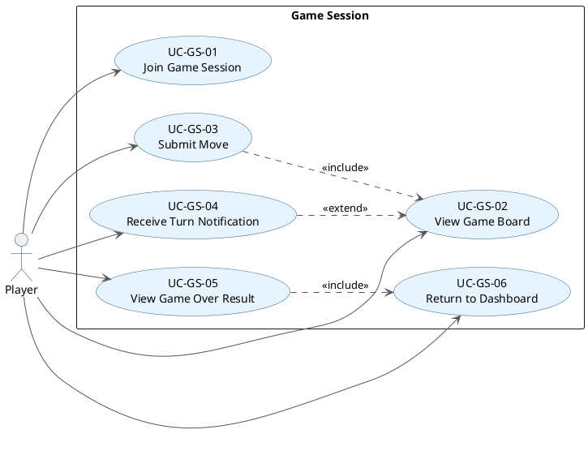

# 03.04 Game Session Use Case Descriptions

## PlantUML Diagram

---

## UC-GS-01: Join Game Session

**Primary actor:** Player
**Goal:** Enter an active game session and see the initial game board.
**Preconditions:** Player is authenticated; a game session has been created and assigned to the player by `GameSessionManager`.

**Trigger:** Player receives a match notification (UC-ML-07) and the system opens the game view.

**Main success scenario:**
1. System verifies the player is assigned to the session.
2. `GameSessionManager.startSession()` initialises the game via `Game.startGame()`.
3. System displays the initial board state via `PlayGame` and `GameGUI`.
4. System indicates whose turn it is.

**Postconditions:** Player is in an active game session and can see the board.

---

## UC-GS-02: View Game Board

**Primary actor:** Player
**Goal:** See the current state of the game board at any point during the session.
**Preconditions:** Player is authenticated and in an active game session.

**Trigger:** Player is on the game screen; system receives a `GameStateUpdate` event.

**Main success scenario:**
1. `PlatformCore` receives `GameStateUpdate` from `EventBus`.
2. System delivers the board state (snapshot or delta) to `GameGUI.renderBoard()`.
3. System highlights whose turn it is and which moves are valid.

**Postconditions:** Board reflects the current game state.

---

## UC-GS-03: Submit Move

**Primary actor:** Player
**Goal:** Submit a move during the player's turn and have it applied to the game state.
**Preconditions:** Player is authenticated; it is the player's turn in an active game session.

**Trigger:** Player selects a move on the game board and confirms.

**Main success scenario:**
1. UI calls `PlatformCore.submitMove(sessionId, move)`.
2. `GameSessionManager` calls `Game.validateAction(PlayerAction, GameState)` via `RuleValidator`.
3. Validation passes; `Game.handleAction()` applies the move.
4. `Game.isGameOver()` returns false.
5. `GameSessionManager` publishes `GameStateUpdate(status=WAITING)` for the opponent and `GameStateUpdate(status=YOUR_TURN)` for the next active player.
6. Board updates for both players.

**Alternate scenario — invalid move:**
1. `RuleValidator.validate()` returns failure with a reason string.
2. System displays the reason to the player (e.g., "That cell is already taken").
3. Player remains on their turn and may try again.

**Alternate scenario — move ends the game:**
- After step 3, `Game.isGameOver()` returns true.
- System proceeds to UC-GS-05.

**Postconditions:** Game state is updated; turn has advanced (or game has ended).

---

## UC-GS-04: Receive Turn Notification

**Primary actor:** Player
**Goal:** Be alerted that it is the player's turn even when not on the game screen.
**Preconditions:** Player is authenticated; player is assigned to an active game session but is currently on the dashboard or lobby screen.

**Trigger:** Opponent submits a valid move; `GameSessionManager` publishes a `GameStateUpdate(status=YOUR_TURN)` event.

**Main success scenario:**
1. `PlatformCore.dispatch()` receives the `GameStateUpdate`.
2. System detects the player is not on the game screen.
3. System displays a turn alert banner or badge on the dashboard/lobby view via `notifyPlayer()`.
4. Player clicks the notification and is navigated to the game screen.
5. System displays the updated board (UC-GS-02).

**Postconditions:** Player is aware it is their turn; board is up to date.

---

## UC-GS-05: View Game Over Result

**Primary actor:** Player
**Goal:** See the outcome of the completed game (win, loss, or draw) and updated rank.
**Preconditions:** A game session has just ended (`Game.isGameOver()` returned true).

**Trigger:** `GameSessionManager` publishes `GameStateUpdate(status=ENDED)`.

**Main success scenario:**
1. `StatsManager.recordResult()` updates `GeneralStats` (win/loss/tie, MMR, rank) for all players.
2. Updated data is pushed to the Database stub.
3. `PlatformCore` fetches updated ranking data and delivers it to all session players via `showResult()`.
4. System displays win/loss/draw result and updated player rank on the game screen.

**Postconditions:** Player stats and rank are updated; result screen is shown.

---

## UC-GS-06: Return to Dashboard

**Primary actor:** Player
**Goal:** Exit the game result screen and return to the main dashboard.
**Preconditions:** Game over result screen is displayed (UC-GS-05 complete).

**Trigger:** Player selects "Return to Dashboard".

**Main success scenario:**
1. UI calls `PlatformCore.returnToDashboard()`.
2. System opens `MainGameDashboard`.
3. Player session state transitions back to `Browsing`.

**Postconditions:** Player is on the dashboard in the `Browsing` state.
