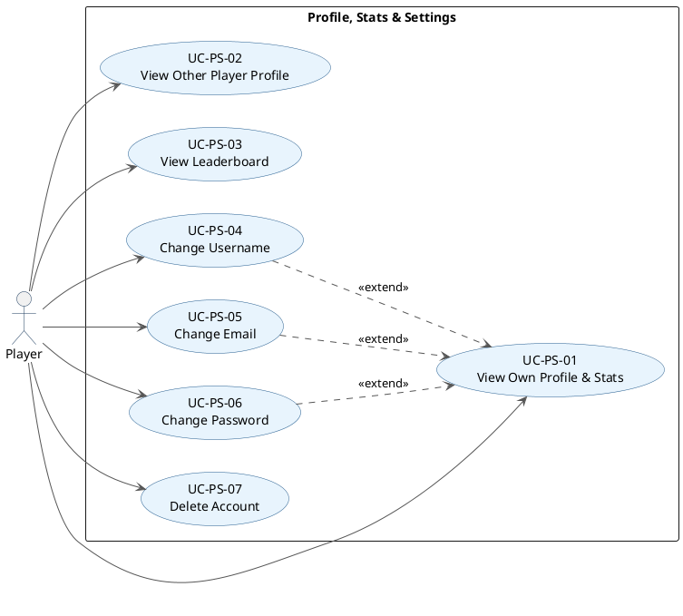

# 03.05 Profile, Stats & Settings Use Case Descriptions

## PlantUML Diagram

---

## UC-PS-01: View Own Profile & Stats

**Primary actor:** Player
**Goal:** See personal game statistics and current rank across all game types.
**Preconditions:** Player is authenticated.

**Trigger:** Player selects "My Profile" or "View Records" from the dashboard or home page.

**Main success scenario:**
1. UI calls `PlatformCore` to fetch the player's dashboard page.
2. System retrieves stats from the Database stub via `PlayerStats`.
3. `ProfileDashboard.displayGameStats(type)` renders statistics separated by game type (Tic-Tac-Toe, Connect Four).
4. System displays: games played, wins, losses, ties, MMR, and current `Rank` for each game type.

**Postconditions:** None (read-only).

---

## UC-PS-02: View Other Player Profile

**Primary actor:** Player
**Goal:** View another player's public profile and statistics.
**Preconditions:** Player is authenticated.

**Trigger:** Player searches for or selects another player's username from the dashboard.

**Main success scenario:**
1. System retrieves the target player's public stats from the Database stub.
2. `ProfileDashboard.displayProfileView()` renders the other player's username, rank, and per-game statistics.

**Alternate scenario — player not found:**
- System displays "Player not found" and returns to the previous screen.

**Postconditions:** None (read-only).

---

## UC-PS-03: View Leaderboard

**Primary actor:** Player
**Goal:** See the top-ranked players for a selected game type.
**Preconditions:** Player is authenticated.

**Trigger:** Player selects "Leaderboard" from the dashboard.

**Main success scenario:**
1. UI calls `Leaderboard.getTopPlayersByRank(gameType)`.
2. System retrieves ranked player data from the Database stub.
3. `MainGameDashboard.showLeaderboard()` renders the ranked list with player names and ranks.
4. Player can switch between game types to view different leaderboards.

**Postconditions:** None (read-only).

---

## UC-PS-04: Change Username

**Primary actor:** Player
**Goal:** Update the player's display name.
**Preconditions:** Player is authenticated.

**Trigger:** Player navigates to Settings and selects "Change Username".

**Main success scenario:**
1. System displays the change username form.
2. Player enters a new username.
3. `Settings.changeUsername(newUsername)` validates the format and checks availability in `CredentialsDatabase`.
4. System updates the username in the User Store stub.
5. System confirms the change.

**Alternate scenario — username already taken:**
- System returns `State.UsernameTaken` and prompts the player to choose a different name.

**Postconditions:** Player's username is updated in the User Store stub.

---

## UC-PS-05: Change Email

**Primary actor:** Player
**Goal:** Update the email address associated with the account.
**Preconditions:** Player is authenticated.

**Trigger:** Player navigates to Settings and selects "Change Email".

**Main success scenario:**
1. System displays the change email form.
2. Player enters a new email address.
3. `Settings.changeEmail(newEmail)` validates the email format.
4. System updates the email in the User Store stub.
5. System confirms the change.

**Alternate scenario — invalid email format:**
- System returns `State.EmailFormatWrong` and prompts the player to re-enter.

**Postconditions:** Player's email is updated in the User Store stub.

---

## UC-PS-06: Change Password

**Primary actor:** Player
**Goal:** Replace the current password with a new one while authenticated.
**Preconditions:** Player is authenticated.

**Trigger:** Player navigates to Settings and selects "Change Password".

**Main success scenario:**
1. System displays the change password form.
2. Player enters the current password and the desired new password.
3. `Settings.changePassword(oldPassword, newPassword)` verifies the current password against the stored bcrypt hash.
4. System hashes the new password and updates it in the User Store stub.
5. System confirms the change.

**Alternate scenario — current password incorrect:**
- System displays an error and prompts the player to re-enter.

**Postconditions:** Player's password hash is updated in the User Store stub.

> **Note:** This covers the authenticated "change password" flow. For the unauthenticated "forgot password" flow, see AUTH-03.

---

## UC-PS-07: Delete Account

**Primary actor:** Player
**Goal:** Permanently remove the player's account from the system.
**Preconditions:** Player is authenticated; player is not currently in an active game session.

**Trigger:** Player navigates to Settings and selects "Delete Account".

**Main success scenario:**
1. System prompts the player to confirm deletion (e.g., enter password to confirm).
2. Player confirms.
3. `Settings.deleteAccount(password)` verifies the password.
4. System removes the account from the User Store stub via `CredentialsDatabase.deleteExistingPlayer()`.
5. System clears the authenticated session.
6. System returns to the welcome/login page.

**Alternate scenario — player is in an active game:**
- System prevents deletion and informs the player to finish or leave the game first.

**Postconditions:** Account no longer exists in the User Store stub; player is unauthenticated.
