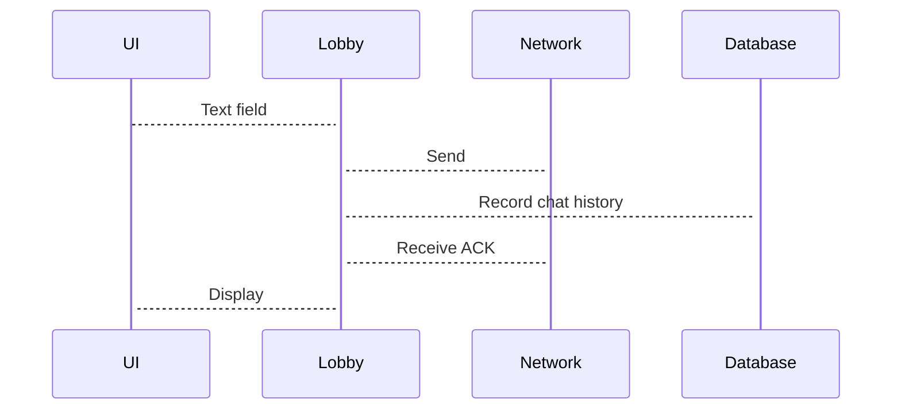
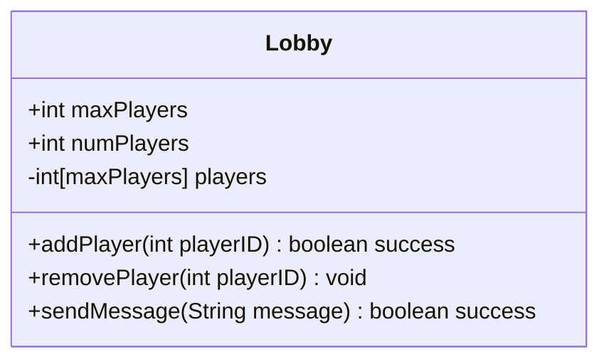

# User Stories
## Minimum Viable Product
1. The user can type a message to another player in their lobby.
2. The user can receive messages from other players in their lobby.
## Bonus/Future Features
1. The user can chat in broader spaces, such as "clan chats" or "global chats".
2. The user can directly message other players (works well with the "profile" designs, we could have e.g. privacy settings?)
3. The user's messages are filtered if they contain inappropriate language (No need to design our own algorithm, that's an implementation detail and it's probably addressed by some library.)
# Sequence Flow
![[Before Game]]
## During Game

# Lobby Class Diagram

> *Architecture remarks.* The `players` array should be **encapsulated** at a coarse-grain level, and we should control who sees who's in a lobby. This protects the privacy of the players (which could be relevant when it comes to stream sniping, e.g.)
> 
> Having a distinct `addPlayer` method allows the Lobby to potentially **reject** a player from being added if they are not authenticated.
# Integration
We should work closely with UI/Client-Side developers to design the chat system, and integrate their UI (for example, a TextField), with logic related to `Lobby`.
Additionally, we might work with Rules/Validation to filter out any bad/inappropriate language.
## Sample Integration API
### UI calls from us:
```java
boolean addPlayer(int playerID);
void removePlayer(int playerID);
boolean sendMessage(String message);
```
### We call from Rules/Validation (if time permits):
```java
String filterMessage(String unfiltered);
```
