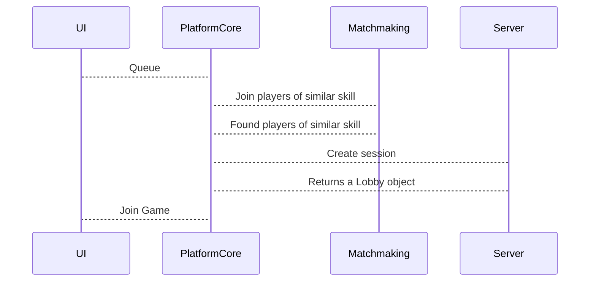

# User Stories
## Minimum Viable Product
- When the game is ready, the user *joins the game.*
	- Note: I am making a slight change to the specification here. After queueing up and finding a ranked match, the user should **not** have a choice to leave (i.e. it's locked at this point.) The game should make them join automatically, and this is how it works in many competitive games (e.g. Chess, Valorant, Brawlhalla)
# Sequence Flow

Related: [[Lobby]]
# Integration
We will obviously need to integrate with UI: e.g. a button for queueing and a screen for "joining" a match. Similarly, Matchmaking will be handled by Rules/Validation
## Sample Integration API
## UI calls from us:
```java
boolean enqueue(int playerID);
```
## We call to Rules/Validation:
```java
int[] matchUp(int playerID);
```
