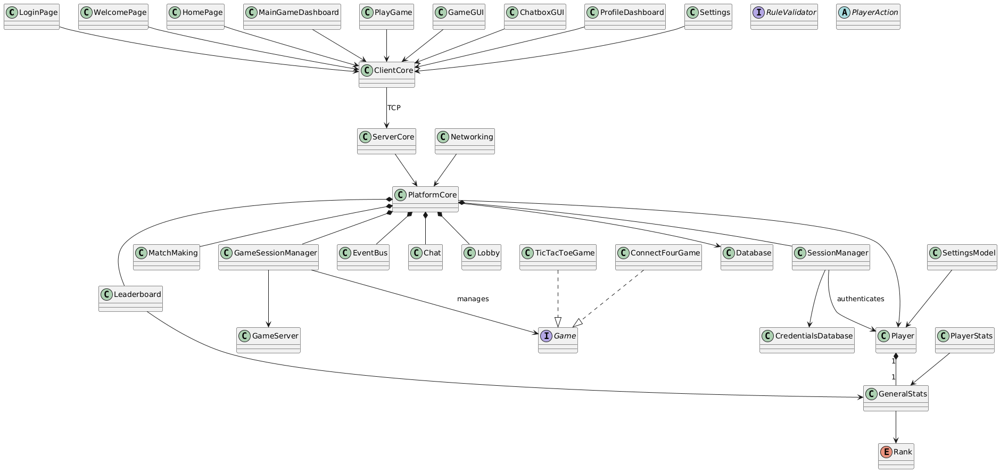

# Multiplayer Game Platform — High-Level Architecture Overview
*Developed by Bogo Solutions*

## Table of Contents

1. [System Purpose](#1-system-purpose)
2. [Architectural Principles](#2-architectural-principles)
3. [Top-Level Component Map](#3-top-level-component-map)
4. [Layer Breakdown](#4-layer-breakdown)
    - 4.1 [UI & Navigation Layer](#41-ui--navigation-layer)
    - 4.2 [Platform Core & Services](#42-platform-core--services)
    - 4.3 [Game Engine Layer](#43-game-engine-layer)
    - 4.4 [Player, Profiles, Stats & Persistence](#44-player-profiles-stats--persistence)
5. [State Machines](#5-state-machines)
    - 5.1 [Player Session State Machine (Platform)](#51-player-session-state-machine-platform)
    - 5.2 [Game Session State Machine](#52-game-session-state-machine)
6. [Key Sequence Flows](#6-key-sequence-flows)
    - 6.1 [Login](#61-login)
    - 6.2 [Sign Up](#62-sign-up)
    - 6.3 [Logout](#63-logout)
    - 6.4 [Join Game (Requirements Met)](#64-join-game-requirements-met)
    - 6.5 [Join Game (Requirements Not Met)](#65-join-game-requirements-not-met)
    - 6.6 [Turn Notification in Lobby/Dashboard](#66-turn-notification-in-lobbydashboard)
    - 6.7 [Game Over → Update Stats → Return to Dashboard](#67-game-over--update-stats--return-to-dashboard)
    - 6.8 [View Player Statistics](#68-view-player-statistics)
7. [Cross-Cutting Concerns](#7-cross-cutting-concerns)
8. [Stub & Integration Points](#8-stub--integration-points)
9. [Technology Stack](#9-technology-stack)

---

## 1. System Purpose

The **Multiplayer Game Platform** is a turn-based online multiplayer game platform developed by Bogo Solutions. It provides shared infrastructure—authentication, matchmaking, game session management, turn handling, player profiles, leaderboards, and notifications—so that any conforming game (Tic-Tac-Toe, Connect Four, etc.) can be hosted and played without rebuilding platform-level concerns.

> **Platform-first principle:** The platform is the product. Sample games exist only to demonstrate and validate platform functionality. Every architectural decision prioritises shared, reusable services over game-specific logic.

---

## 2. Architectural Principles

| Principle | Description |
|---|---|
| **Platform owns notifications** | `GameSessionManager` emits `GameStateUpdate` events; `PlatformCore` decides who to notify and how, regardless of where the player currently is (lobby, dashboard, or in-game). |
| **GameEngine returns state only** | `Game` implementations return state (or deltas). They do NOT notify the lobby, dashboard, or UI. Core services consume returned state and emit `GameStateUpdate`. |
| **UI calls PlatformCore APIs** | The UI layer calls `PlatformCore` APIs (`submitMove`, `joinQueue`, `joinLobby`). It never calls `GameEngine` internals. |
| **Stubs for external systems** | Database, networking/server, and cloud hosting are represented by stub classes. Architecture is designed so a real implementation can be swapped in at the stub boundary without structural changes. |
| **Event-driven decoupling** | `GameStateUpdate` is the contract between game logic and everything else. No direct calls from game layer to UI. |
| **Privacy by design** | `Lobby.players` is encapsulated; external code cannot enumerate who is in a lobby. |
| **Single responsibility** | Each service owns one lane: matchmaking, sessions, lobby, leaderboard, or chat. |

---

## 3. Top-Level Component Map




---

## 4. Layer Breakdown

### 4.1 UI & Navigation Layer

The UI layer is the player-facing surface. It is passive: it **subscribes** to `PlatformCore` notifications and renders state; it never drives game logic.

| Class | Responsibility |
|---|---|
| `WelcomePage` | Entry point; displays welcome message |
| `AuthenticationScreen` | Displays login and registration screens; calls `LoginPage.login()` / `register()` |
| `LoginPage` | Delegates login/register to `PlatformCore`; returns `HomePage` or error `State` |
| `HomePage` | Player home; entry to profile, settings, and game selection |
| `MainGameDashboard` | Central hub; `displayGames`, `chooseGame`, `viewProfile`, `showLeaderboard`; joins queue; receives state updates and turn alerts from `PlatformCore` |
| `ProfileDashboard` | Displays profile view and per-game stats |
| `Settings` | Exposes account management (`changeUsername`, `changeEmail`, `changePassword`, `logout`) |
| `PlayGame` | Manages active game view; calls `PlatformCore.submitMove()`; receives board updates |
| `GameGUI` | Renders the game board (`setupUIWindow`, `renderBoard`, `updateUI`) |
| `ChatboxGUI` | In-game chat display |
| `State` (enum) | Login/register error states: `UsernameTaken`, `EmailFormatWrong`, `VerificationCodeWrong` |

**Navigation flow:** `WelcomePage → AuthenticationScreen → LoginPage → HomePage → MainGameDashboard ↔ PlayGame`

---

### 4.2 Platform Core & Services

This is the central nervous system of the platform. All game events and player notifications are routed through here. It sits behind a TCP network layer: `ClientCore` on the client side communicates with `ServerCore`, which owns `PlatformCore` and all its services.

#### `PlatformCore` *(service)*
Central dispatcher. Owns `EventBus`, `MatchMaking`, `GameSessionManager`, `Leaderboard`, `Chat`, and `Lobby`.
- **`dispatch(event)`** — receives `GameStateUpdate` events from `EventBus`; routes notifications to the correct players regardless of what screen they are on
- **`notifyPlayer(playerId, msg)`** — delivers notification (lobby banner, badge, in-game update)
- **`submitMove(sessionId, move)`** — proxies move submission from UI to `GameSessionManager`
- **`joinQueue(gameType)`** — proxies ranked queue entry from UI to `MatchMaking`
- **`joinLobby(playerId, gameType)`** — proxies unranked lobby entry from UI to `Lobby`

#### `GameSessionManager` *(service)*
Owns the move pipeline. Calls `Game` interface methods; emits `GameStateUpdate` on move accepted/rejected, turn changes, and game end.

| Method | Behaviour |
|---|---|
| `startSession(roomId, gameType)` | Creates a game session; returns `sessionId` |
| `submitMove(sessionId, playerId, move)` | Calls `Game.validateAction` → `handleAction` → `isGameOver`; publishes `GameStateUpdate` |
| `endSession(sessionId)` | Tears down the session |

#### `EventBus` *(service)*
Simple pub/sub bus. `GameSessionManager` publishes `GameStateUpdate` events here; `PlatformCore` subscribes.

#### `GameStateUpdate` *(event)*
The canonical message passed between game layer and platform layer.

| Field | Type | Description |
|---|---|---|
| `sessionId` | String | Identifies the game session |
| `recipients` | List\<String\> | Player IDs who should receive this update |
| `status` | String | `YOUR_TURN`, `WAITING`, `ENDED` |
| `activePlayerId` | String | Which player acts next |
| `payload` | Object | Board snapshot or delta |

#### `GameStatus` *(enum)*
`LOBBY → MATCHMAKING → STARTING → IN_PROGRESS → GAME_OVER`

#### `GameState`
Server-side snapshot of a running session.

| Field | Description |
|---|---|
| `sessionId` | Identifies the session |
| `gameType` | Which game is being played |
| `status` | Current `GameStatus` |
| `activePlayerId` | Player whose turn it is |
| `board` | Current board representation |

#### `MatchMaking` *(service)*
Handles ranked queue management by `gameType` with skill-based player matching.
- `addPlayerToQueue(playerId, gameType)` — adds player to ranked queue
- `removePlayer(playerId)` — dequeues player
- `matchPlayers(gameType): List<String>` — returns matched player IDs; triggers `PlatformCore` when match is found

#### `Lobby` *(service)*
Handles unranked match creation and discovery. Players in a lobby can chat while waiting.
- `createLobby(): String` — creates a new lobby; returns lobbyId
- `getAvailableLobbies(): List` — returns joinable lobbies
- `addPlayerToLobby(lobbyId, playerId)` — adds a player to a lobby

> `Lobby.players` is encapsulated — external code cannot enumerate who is in a lobby.

#### `Chat` *(service)*
Per-lobby messaging. Encapsulates the player list for privacy.
- `sendMessage(msg)` — broadcasts a message to lobby members
- `filterMessage(msg)` *(optional)* — content filtering hook called by `PlatformCore`

#### `Leaderboard` *(service)*
- `logGameResult(sessionId)` — records result after game ends
- `updatePlayer(playerId)` — recalculates rank/MMR
- `getTopPlayersByRank(gameType): List<String>` — returns ranked player list

Backed by `Database` (stub).

#### `SessionManager`
Manages authentication sessions: creates session tokens on login, invalidates them on logout, stores session data locally.

---

### 4.3 Game Engine Layer

The game layer defines a shared abstraction that allows multiple games to run on the same platform infrastructure while sharing networking, session management, and validation logic. The platform interacts only with these abstractions and does not depend on any game-specific logic.

#### `Game` *(interface)*

Represents a single running match of any game type.

**Responsibilities:**
- Initialize and start a game session
- Accept player actions
- Validate actions before applying them
- Maintain and expose game state
- Send just the changes (updates) instead of whole game state to the client
- Determine when the game has ended

| Method | Description |
|---|---|
| `startGame()` | Initializes and starts the game session |
| `handleAction(PlayerAction action)` | Accepts and processes a player action |
| `validateAction(PlayerAction action)` | Validates an action before it is applied |
| `getGameState()` | Returns the current full game state |
| `getGameUpdate()` | Returns only the changes since last update |
| `isGameOver()` | Returns whether the game has ended |

#### `PlayerAction` *(abstraction)*

All player inputs are represented as a generic action object interpreted by the active game. The platform does not interpret the contents of actions; it only routes them to the correct game instance.

| Field | Description |
|---|---|
| Player ID | Identifies which player submitted the action |
| Action type | e.g., `MOVE`, `HIT`, `STAND` |
| Action payload | Game-specific data; format differs between games |

Each game provides its own concrete implementation of `PlayerAction`.

#### `RuleValidator` *(interface)*

Validation logic is separated from game flow logic. Each game provides its own implementation.

**Responsibilities:**
- Determine whether a proposed action is legal
- Enforce turn order and game-specific constraints
- Prevent invalid state transitions
- Upon validation failure, return a reason why it failed rather than a mere boolean
- Provide a list of valid moves to the client

| Method | Description |
|---|---|
| `validate(PlayerAction action, GameState state)` | Returns validation result with failure reason if invalid |
| `getValidActions()` | Returns the list of currently legal actions |

#### Tic-Tac-Toe Implementation

**Components:**
- `TicTacToeGame` (implements `Game`)
- `TicTacToePlayerAction` (concrete `PlayerAction`)
- `TicTacToeRuleValidator` (implements `RuleValidator`)
- `TicTacToeGameState` (board positions, current player)

#### Connect Four Implementation

**Components:**
- `ConnectFourGame` (implements `Game`)
- `ConnectFourPlayerAction` (concrete `PlayerAction`)
- `ConnectFourRuleValidator` (implements `RuleValidator`)
- `ConnectFourGameState` (board positions, current player)

#### Interaction Flow (Game Layer)

1. Client sends an action to the server
2. Platform routes the action to the active `Game` instance
3. `Game` requests validation from its `RuleValidator`
4. If valid, the game state is updated
5. Updated state is returned to the platform for broadcasting

> **Rule:** Game implementations never call UI or platform notification methods. They only return state objects to `GameSessionManager`.

---

### 4.4 Player, Profiles, Stats & Persistence

#### `Player`
Central domain object representing an authenticated user.

| Member | Description |
|---|---|
| `playerId: String` | Unique identifier |
| `username: String` | Display name |
| `email: String` | Contact / login credential |
| `password: String` | Stored as bcrypt hash |
| `ranking: Rank` | Current overall rank |
| `getStats(gameType): GeneralStats` | Per-game statistics |
| `login()` / `logout()` | Session hooks |

#### `GeneralStats`
Per-player, per-game statistics: `gamesPlayed`, `wins`, `losses`, `ties`, `mmr`, `rank`. Exposes `win()`, `lose()`, `tie()`, `updateMMR(win)`, `updateRank()`.

#### `Rank` *(enum)*
`BRONZE → SILVER → GOLD → PLATINUM → DIAMOND → MASTER → GRANDMASTER`

#### `PlayerStats`
Convenience wrapper providing game-specific stat getters (`getWinsForConnect4()`, `getRankForTicTacToe()`, etc.) by delegating to `GeneralStats`.

#### `Settings`
Account management operations (change username/email/password, delete account, logout). References both `Player` and `CredentialsDatabase`.

#### `CredentialsDatabase` *(stub)*
In-memory `HashMap<String, Player>` store. Provides:
- `usernameLookup`, `addNewPlayer`, `deleteExistingPlayer`
- `findPlayerByUsername`, `saveDatabase(filename)`, `loadDatabase(filename)`

> Plan: HashMap or file load/unload. No external DB required for the stub.

---

## 5. State Machines

### 5.1 Player Session State Machine (Platform)

This machine tracks a single player's lifecycle across the entire platform.


**Key constraints:**
- Logout is only permitted from `Browsing` — never mid-game
- Ranked matches: player is auto-joined on `matchAssigned`; no option to decline
- Unranked matches: player joins a `Lobby`; can chat while waiting for others to ready up
- `PlatformCore` can send notifications to a player regardless of their current state

---

### 5.2 Game Session State Machine

This machine tracks a single game session (game-agnostic).

**Insert Image** // TO DO

**Every transition emits a `GameStateUpdate` to Core containing:** `activePlayerId`, `allowedActions`, board snapshot (or delta), and `status` (`YOUR_TURN / WAITING / ENDED`).

---

## 6. Key Sequence Flows

> **How to insert images:** In Markdown, use the syntax ``. For a local file in the same folder as this document, use a relative path like ``. For a file in the same directory, just `` works too. The alt text (inside `[ ]`) is shown if the image fails to load and is good practice for accessibility.

---

### 6.1 Login


---

### 6.2 Sign Up


---

### 6.3 Logout


---

### 6.4 Join Game (Requirements Met)


---

### 6.5 Join Game (Requirements Not Met)


---

### 6.6 Turn Notification in Lobby/Dashboard


---

### 6.7 Game Over → Update Stats → Return to Dashboard


---

### 6.8 View Player Statistics


---

## 7. Cross-Cutting Concerns

### Notification Routing
`PlatformCore` is the single authority for routing notifications. After receiving a `GameStateUpdate` from the `EventBus`, it inspects each recipient's current UI state:
- If the recipient is on the **game screen** → deliver board/turn update directly to `PlayGame`
- If the recipient is in the **lobby/dashboard** → deliver a turn alert banner/badge via `PlatformCore.notifyPlayer()`

This ensures turn notifications reach players regardless of where they are in the application.

### Move Pipeline
All move submissions pass through the same pipeline regardless of game type:

```
UI.submitMove()
  → PlatformCore.submitMove()
    → GameSessionManager.submitMove()
      → Game.validateAction()          [game-specific, returns reason on failure]
      → Game.handleAction()            [game-specific]
      → Game.isGameOver()              [game-specific]
      → publish(GameStateUpdate)       [platform-level]
        → EventBus → PlatformCore → notify recipients
```

### Authentication & Session Management
All authentication flows use bcrypt-hashed passwords. Session tokens are issued by `SessionManager` on successful login/registration and invalidated on logout. The `CredentialsDatabase` stub uses an in-memory `HashMap`; the real DB can be swapped in at that boundary.

### Rank & MMR
`GeneralStats.updateMMR(win)` and `updateRank()` are called by `StatsManager` (invoked by `GameSessionManager`) after every game ends. The `Rank` enum defines seven tiers (Bronze → Grandmaster). `Leaderboard.updatePlayer()` reflects changes globally.

---

## 8. Stub & Integration Points

The following components are stubs with clearly defined interfaces, ready for replacement with real implementations:

| Stub | Interface Contract | Replaces |
|---|---|---|
| `CredentialsDatabase` | `addNewPlayer`, `usernameLookup`, `findPlayerByUsername`, `saveDatabase` / `loadDatabase` | User authentication database |
| `Database` | `storeData()`, `retrieveData()` | Game data storage (match history, leaderboard, stats) |
| `Networking` | `handleConnections`, `syncPlayers`, `sendPlayerActions`, `disconnectPlayer`, `reconnectToGame` | Cloud hosting / server infrastructure |
| `GameServer` | `createSession(players, gameType): sessionId` | Online game server / cloud hosting |

All stubs are marked with the `«stub»` stereotype in the class diagrams and contain hardcoded test data for local execution.

---

## 9. Technology Stack

| Concern | Technology                                   |
|---|----------------------------------------------|
| Language | Java (JDK)                                   |
| IDE | IntelliJ IDEA                                |
| UI Framework | JavaFX, Swing, or FXGL                       |
| Version Control | GitLab (csgit.ucalgary.ca)                   |
| Build / Run | Standard Java build (instructions in README) |
| Documentation | Markdown Files, PDF, PNG diagrams            |
| Database (stub) | In-memory `HashMap` / file load-unload       |

---

*Document version: aligned with design artifacts v1.0.0 (Iteration 1). This document is a living artifact and will be updated as implementation progresses through Iterations 2 and 3.*